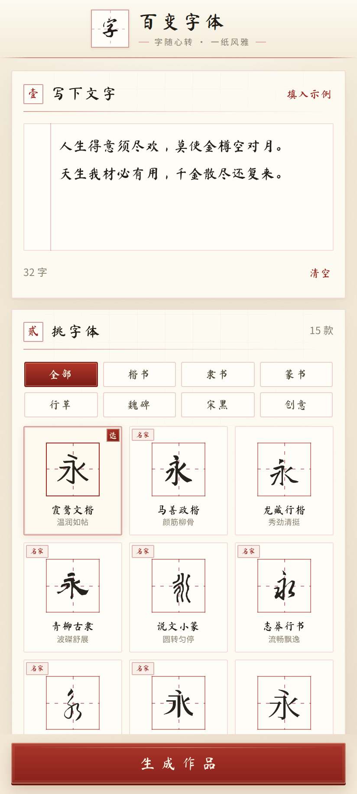

# 百变字体

**输入一段文字，选一种字体、一种版式，一键生成整篇统一协调的书法作品图。**

Android · 完全离线 · 不申请联网权限 · 开源

📦 **[下载安装包：BaiBianFont-v2.3.apk](https://github.com/donghuaigu123/bai-bian-zi-ti/releases/download/v2.3/BaiBianFont-v2.3.apk)**（Android 6.0 / API 23 及以上）


---

## 界面：整屏就是一张字帖

图标、首页、卡片、结果页共用同一套语汇：**宣纸、朱框、朱丝田字格、墨字**。

- **图标**：一张宣纸练习纸——纸边一道朱色细框，里面是加重的朱丝田字格，格中一个行书「字」，端正不倾斜；
  自适应图标把纸纹与格字分层，圆形、圆角方裁切下都完整；
- **顶栏**：左边一枚小田字格，格里行书「字」，与图标同源；
- **卡片**：浅朱细边，卡面铺极淡的格子纸纹理，步骤用「壹 · 贰 · 叁」压在方格印里；
- **输入框**：一页信笺——左侧一道朱丝栏线，正文用内置楷书；
- **字体卡**：每张卡里就是一枚田字格，格中一个「永」，选中的那张朱框加深；
- **结果页**：撤掉原来的深墨底，改用纸色，作品以白卡纸加朱丝细边装裱，像从字帖上揭下来的一页。

<p align="center">
  
  
  
</p>

---

## 为什么做这个

用手机做书法字体图，常见的坑是这四个：

1. 字体不全，生僻字变成方框（豆腐块）；
2. 一篇文字里混进好几种字体，看着乱；
3. 排版参数一大堆，调半天也不好看；
4. 导出的图糊，或者存不进相册。

「百变字体」把这四件事一次性解决：**字库缺字自动补齐、整篇只用一种字体、参数默认就好看、1080px 高清原图批量进相册**。

## 三步就完事

> ① 写下文字 → ② 点一个字体 → ③ 点「生成作品」

字体卡上直接显示该字体的「永」字样张，不用挨个试。版式给了一套调好的默认值，想改再展开「更多排版设置」；也可以点「随手一换」直接换一套。

## 字体：15 款，覆盖全部主要书体（12 款内置字库 + 系统黑体 + 2 款风格化）

| 书体 | 字体 | 风格取向 | 收字 |
|------|------|----------|------|
| 楷书 | 霞鹜文楷 | 温润如帖 | 2 万余字 |
| 楷书 | 马善政毛笔楷 | 颜真卿风 | 6763 |
| 行楷 | 龙藏体 | 秀劲清挺 | 6763 |
| 隶书 | 青柳古隶 | 曹全碑风 | 12204 |
| 篆书 | 说文小篆 | 李斯小篆风 | 4752 |
| 行书 | 志莽行书 | 兰亭序风 | 6763 |
| 草书 | 刘建毛草 | 怀素自叙风 | 6763 |
| 魏碑 | 站酷小薇 | 张猛龙碑风 | 6763 |
| 宋体 | 思源宋体（子集） | 长篇首选 | 6763 |
| 圆黑 | 站酷庆科黄油 | 圆润亲和 | 7066 |
| 创意 | 站酷快乐 | 轻松手账 | 6766 |
| 马克笔 | 霞鹜漫黑 | 手写标签感 | 12771 |
| 现代 | 系统黑体 | 简洁 | 系统字体 |
| 风格化 | 汉隶风 / 金石风 | 横向扁展 / 竖向修长 | 基于上述字库变形 |

字体按 **楷 / 隶 / 篆 / 行草 / 魏碑 / 宋黑 / 创意** 分类，点分类可筛选。

以上 **15 款全部随 APK 打包**，不联网、不读取外部字体文件。

## 排版：可以自由组合

| 维度 | 选项 |
|------|------|
| 纸张 | 宣纸、素白、仿古、墨拓、洒金、靛青 |
| 方向 | 横排、竖排（右起，符合传统书写） |
| 字号 | 自动 / 小 / 中 / 大 / 特大 |
| 字距 | 紧凑 / 标准 / 宽松 |
| 行距 | 紧凑 / 标准 / 疏朗 |
| 对齐 | 左 / 中 / 右（横排） |
| 界格 | 无 / 方格 / 竖栏（朱丝栏）/ 田字格 / 米字格 |
| 页边距 | 窄 / 标准 / 宽 |
| 标题 | 任意文字，自动加装饰线 |
| 落款 | 任意文字，位置随横竖排自动调整 |
| 印章 | 朱文印 / 白文印 / 不要 |

上述维度自由组合超过 **1 万种版式**，且标题、正文、落款、印章**共用同一字体**，不会出现风格打架。

## 不会出现方框

书法字库普遍收字不全（小篆只有 4752 个字形）。做法是：

1. 构建时读取每个字库的 `cmap`，生成一张 BMP 覆盖位图（每款 8KB）；
2. 运行时逐字做 O(1) 查询，**只有缺的那一个字**改用楷书绘制，其余保持不变；
3. 结果页明示「N 字以楷书补齐」，补了几个字你一眼就知道。

## 出图与保存

- 1080px 宽，PNG 无损，长文自动分页且**每页尺寸完全一致**（套图不会一大一小）；
- 短句单页高度会自动贴合内容，不会出现一张细长条；
- 点一次「保存全部到相册」，多页全部写入 `Pictures/百变字体/`。

## 自己构建

不需要 Gradle 或 Android Studio，只要有 JDK 11+ 与 Android SDK（build-tools 34、platform 34）：

```bash
export ANDROID_HOME=/path/to/android-sdk
./build.sh
# 产物：百变字体-v2.0.apk
```

构建脚本会依次执行：生成派生资源（字体清单 / 缺字位图 / 缩略图）→ `aapt2` 编译与链接 →
`javac` → `d8` → `zipalign` → `apksigner`（v1+v2+v3 三重签名）。

## 目录结构

```
app/
  AndroidManifest.xml
  java/com/baibianziti/app/MainActivity.java   WebView 壳：虚拟 HTTPS 源 + 相册保存
  res/                                          图标与字符串
  assets/
    index.html  app.css  app.js                 界面与渲染引擎
    fonts/                                      12 款字库 + 许可原文 + 缩略图
    fonts.js  font-coverage.js                  构建生成的清单与缺字位图
scripts/
  gen_assets.py                                 生成字体清单 / 缺字位图 / 缩略图
  make_icon.py                                  生成应用图标（纸框 + 田字格 + 自适应前景/背景）
build.sh                                        一键构建
FONTS.md                                        字体来源与授权说明
```

## 实现要点

- **虚拟 HTTPS 同源**：页面与字体由 `shouldInterceptRequest` 从 assets 返回，挂在同一个
  `https://` 源下。这是 `canvas.toDataURL()` 能稳定导出图片的前提——`file://` 下的
  `@font-face` 会被判定为跨域，进而污染 canvas，导致导出失败。
- **逐字绘制**：正文不是一次性 `fillText` 整行，而是逐字定位绘制，这样才能逐字判断缺字、
  逐字做隶/篆的风格化变形，并精确控制字距。
- **先排版后分页**：先按字体度量算出断行/断列，再按固定版心切页，所以多页尺寸天然一致。
- **图片分块回传**：`toDataURL` 的结果按 96KB 分块经 JS 桥传回原生层，规避单次大字符串限制。

## 版本

| 版本 | 内容 |
|------|------|
| 2.3 | 移除「导入我的字体」：去掉顶栏入口、原生文件选择器与自有字体分类，只保留内置 15 款；顶栏改为居中题名 |
| 2.2 | 首页 / 卡片 / 结果页统一为「宣纸 + 朱丝田字格」；图标田字格加深、纸边加朱框；修正短文本上下留白与若干对齐问题 |
| 2.1 | 图标改为「宣纸 + 朱丝田字格 + 行书『字』」，摆正不倾斜；其余同 2.0 |
| 2.0 | 全新图标与界面（宣纸朱印 · 书斋意象）；状态栏融入纸色；排版与出图逻辑不变 |
| 1.0 | 首个版本：15 款字体、六种纸张、横竖排与界格、自动分页、缺字回退 |

## 授权

- **代码**：MIT，见 [LICENSE](./LICENSE)。
- **字体**：不适用 MIT，各自遵循原始授权（多为 SIL OFL 1.1），详见 [LICENSE-FONTS.md](./LICENSE-FONTS.md)。
  授权原文随 APK 打包，逐款来源与注意事项见 **[FONTS.md](./FONTS.md)**。

> 界面上标「名家」的字体，指的是该字库的**风格取向**（如颜体风、兰亭风），
> 不是名家真迹集字——真迹集字字库均为商业授权，无法合法打包进开源项目。

## 已知限制

- 小篆（4752 字形）与青柳古隶（日文字集）收字有限，简体长文会有较多字回退楷书，
  写短句、吉祥语、繁体传承字形效果最佳；正文长篇建议选宋体或霞鹜文楷。
- 「汉隶风 / 金石风」是对开源字库做的横展 / 竖展变形，不是独立的隶书、篆书字库。
- 本项目在 Linux 沙箱中完成编译与 40 余项浏览器端自动化验收，
  **原生层（相册写入）未在真机点击验证**。

## 致谢

字库作者：马善政、龙藏、志莽、刘建、青柳衡山、霞鹜（LXGW）、站酷（ZCOOL）、
Adobe 与 Google（思源宋体）。感谢他们把字库以自由许可的方式开放出来。
